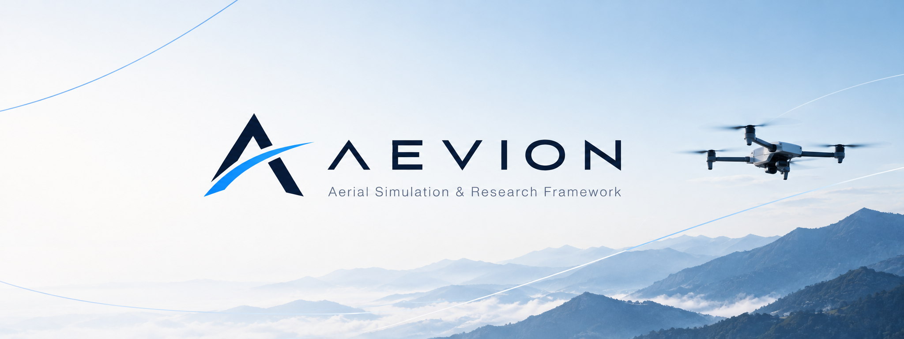

<p align="center">
  
</p>

# Aevion

A Python simulator for UAV research that runs on a laptop CPU and scales to a CUDA GPU through the same API.

Aevion simulates multirotors and small fixed-wing aircraft with a 6-DOF model, and adds sensors (IMU, GNSS, barometer,
magnetometer, rangefinder, LiDAR, depth and RGB cameras), wind and atmosphere, air-to-ground radio links and multi-vehicle
swarms. Environments follow the Gymnasium API and also run as batched tensors for machine learning. Each run is saved as a
reproducible archive that can be replayed in 3-D and turned into research-grade figures.

It is meant to sit alongside GPU simulators such as Isaac Sim. It installs with `pip`, runs on a CPU, and handles thousands
of parallel vehicles on a CUDA GPU.

```text
pip install -e ".[all]"          # numpy+scipy core; extras: fast (numba), torch, gym, viz, hdf5, yaml, parquet
aevion demo --world forest --open
aevion init sim.yaml && aevion validate sim.yaml && aevion run sim.yaml --stream --open
```

The demo flies a figure-eight through a forest in turbulence with a full sensor suite, saves an archive, writes a report with
figures and derived findings, and opens a 3-D replay.

---

## What is inside

Each row links to its section in [DOCUMENTATION.md](DOCUMENTATION.md).

| Area | Contents |
|---|---|
| Dynamics | 6-DOF Newton–Euler on quaternions; per-rotor thrust and torque, motor lag, rotor gyroscopics, body and rotor drag, ground effect, payload, LiPo battery, ground contact and obstacle collisions. RK4, midpoint, semi-implicit and Euler integrators with automatic sub-stepping. See [Mathematical models](DOCUMENTATION.md#mathematical-models). |
| Vehicles | Presets (Crazyflie, 5" racer, 1 kg research, 2 kg camera, 3 kg hexacopter) and quad, hexa and octo generators; blade-element-momentum propellers, BLDC and ESC models, battery pack with Peukert, thermal and ageing effects, slung loads, ceiling and wall effects; fixed-wing and quad-plane/tilt-rotor VTOL aircraft with trim, linearisation and autopilots. See [Vehicle realism and aircraft](DOCUMENTATION.md#vehicle-realism-and-aircraft). |
| Environment | Gravity models (constant, inverse-square, WGS-84, Moon, Mars), ISA atmosphere, Dryden turbulence (MIL-F-8785C), gusts, shear, log-law, gridded and urban-wake wind; WGS84 geodesy, sun position, magnetic field, weather; terrain, OBJ/STL/glTF meshes with a BVH, OSM/GeoJSON buildings, moving obstacles, geofences and signed-distance fields. See [Environment](DOCUMENTATION.md#environment). |
| Sensors | Allan-variance IMU, pseudorange GNSS, barometer, pitot, optical flow, ultrasonic, UWB, magnetometer, FMCW radar, LiDAR with several scan patterns, cameras with pinhole and fisheye lenses, rolling shutter and thermal mode, an event camera, and a sensor-fault library. Every sensor has a rate, latency and dropout. See [Sensors](DOCUMENTATION.md#sensors). |
| Control | Geometric SE(3), cascaded PID and LQR controllers, minimum-snap and reference trajectories, fault-tolerant rotor allocation, MPC with a disturbance observer, MPPI, INDI, L1 adaptive and sliding-mode control. See [Advanced control](DOCUMENTATION.md#advanced-control). |
| Planning | Voxel planning space; A*, Theta*, D* Lite, RRT*, PRM; minimum-snap and time-optimal trajectories; ORCA-3D and control-barrier-function avoidance; behaviour-tree missions. See [Planning and avoidance](DOCUMENTATION.md#planning-and-avoidance). |
| Estimation | A 15-state error-state Kalman filter (IMU, GNSS, barometer, magnetometer, rangefinder, optical flow, pose) with delayed measurements and gating, NEES/NIS consistency checks, observability analysis, occupancy mapping, and simpler attitude and navigation filters. See [State estimation](DOCUMENTATION.md#state-estimation). |
| Bridges | MAVLink v1/v2, `.tlog` and PX4 ULog files, hardware/software-in-the-loop over MAVLink, ROS 2 messages and a publisher, and [system identification](DOCUMENTATION.md#system-identification-1) from flight logs. Not yet tested against real PX4, ArduPilot or ROS 2. See [Bridges](DOCUMENTATION.md#bridges-mavlink-px4-logs-hil-and-ros-2). |
| Wireless | 3GPP TR 38.901 and TR 36.777 path loss, ray tracing through your buildings, time-correlated fading, UAV-attitude antennas and beam management, MIMO and blockage, a 5G-NR-style network (handover, radio-link failure, schedulers, link adaptation with HARQ, interference), RIS, satellite links, radio maps, jamming and spoofing as engine faults, link metrics, a communication-aware RL task and ns-3 export. See [Wireless](DOCUMENTATION.md#wireless). |
| Multi-agent | Formations, lossy and delayed inter-agent links, decentralised collision avoidance, consensus, Hungarian, auction and CBBA allocation, Voronoi coverage, 4-D conflict detection, space-time planning, swarm laws, and a cooperative environment with a PettingZoo-style API. See [Multi-agent coordination](DOCUMENTATION.md#multi-agent-coordination). |
| Machine learning | Gymnasium environments, a tensor-native `VecQuadEnv` (NumPy, torch CPU, CUDA), four action modes, hover, waypoint, tracking and LiDAR-navigation tasks plus gate racing, landing, inspection and coverage, domain randomisation, a Stable-Baselines3 adapter, behaviour cloning and DAgger, D4RL-style datasets, ONNX and TorchScript export, experiment tracking, Optuna tuning, differentiable dynamics, and [vision datasets](DOCUMENTATION.md#vision-datasets-1) with COCO/YOLO labels, depth and optical flow. See [Machine learning guide](DOCUMENTATION.md#machine-learning-guide). |
| Experiments | Method × condition × seed grids with paired random draws, Welch and Mann–Whitney tests, Holm correction, effect sizes and bootstrap intervals; Latin-hypercube, Sobol and Halton designs, Morris and Sobol sensitivity analysis, Bayesian optimisation, a resumable cache, Slurm-array runners, a SQLite result database and benchmark suites. See [Experiments](DOCUMENTATION.md#experiments). |
| Engine | A config-driven `Simulation` with a deterministic multi-rate scheduler, event bus, hooks, fault injection (rotor, sensor, wind and communication faults), health watchdogs and plugin registries. See [Architecture](DOCUMENTATION.md#architecture). |
| Reproducibility | Each run is a self-describing archive (`.aevd`): chunked, streamable, lazily readable and BLAKE2b-verified, with provenance and a run registry. `aevion verify` re-simulates a run and compares it bit for bit; `aevion diff` lists what changed. See [Run archives](DOCUMENTATION.md#run-archives). |
| Visualisation and figures | A WebGL viewer that works in any browser without a network connection: single-file replays, a local server for long runs, live streaming, run comparison, wireless layers, LiDAR, charts, MP4/GIF/screenshot export, a notebook widget and a scene editor. Research-grade figures (column sizes for IEEE, ACM, Elsevier and Springer), with Bode, pole-zero, Allan, NEES, ROC and ridgeline plots and an auto-generated methods appendix. See [Analysis and research-grade figures](DOCUMENTATION.md#analysis-and-research-grade-figures). |

## Quick start

```python
import numpy as np
from aevion import Multirotor, World
from aevion.control import GeometricController, Reference

sim = Multirotor("generic_1kg", n=1000, dt=0.005)          # 1000 drones, CPU (numba) by default
ctrl = GeometricController(sim); ctrl.reset(sim.n)
state = sim.reset(pos=[0, 0, 1.0])
ref = Reference.hover(sim.B, sim.n, pos=(1.0, 2.0, 3.0))
for _ in range(1000):
    state = sim.step(state, ctrl.act(state, ref, sim.dt))
print(state.pos[0])                                         # ≈ [1, 2, 3]
```

The same code runs on a GPU: `Multirotor("generic_1kg", n=100_000, backend="cuda")`.

### Declarative configuration, engine, faults, hooks

```yaml
schema_version: 1
name: gps_outage_demo
duration: 20
world: {type: forest, n_trees: 30}
wind:  {type: dryden, w20: 5.0}
controller: {type: geometric, ki_pos: 3.0}
trajectory: {type: figure8, center: [0, 0, 3], size: 3, period: 9}
sensors: [imu, gps, baro, mag]
estimator: mahony_kf
faults:
  - {type: gps_outage, t_start: 8, t_end: 12}
  - {type: rotor_failure, t_start: 15, rotor: 1}
```

```python
from aevion.config import load_config
from aevion.engine import Simulation, CallbackHook

sim = Simulation(load_config("gps_outage_demo.yaml"), hooks=[CallbackHook(post_step=lambda s: ...)])
archive = sim.run()     # lazily-readable, hashed, with provenance
```

A bad config is reported with the path of every problem and a "did you mean" hint. Every run records its configuration, kernel and
provenance, and `aevion verify` reproduces it bit for bit. See [Architecture](DOCUMENTATION.md#architecture).

### Scenario, archive, replay, report

```python
from aevion.scenario import Scenario
from aevion.analysis.report import build_report

sc = Scenario(
    name="figure8_forest", vehicle="generic_1kg", world={"kind": "forest", "n_trees": 40},
    wind={"type": "DrydenTurbulence", "w20": 5.0, "severity": 1.0},
    controller="geometric", controller_kwargs={"ki_pos": 3.0},
    trajectory=dict(kind="figure8", center=[0, 0, 3], size=3.0, period=9.0),
    sensors=["imu", "gps", "baro", "mag", "lidar"], record_sensors=["imu", "lidar"], duration=20, seed=7,
)
archive = sc.run()
archive.save("run.aev")
build_report(archive, "report/")          # figures (PDF+PNG), metrics (CSV/LaTeX), insights, replay.html
```

### Train a policy

```python
from stable_baselines3 import PPO
from aevion.envs import make_sb3_vec_env, DomainRandomization

env = make_sb3_vec_env(64, task="hover", action_mode="velocity", domain_randomization=DomainRandomization.mild())
PPO("MlpPolicy", env, device="cuda").learn(2_000_000)
```

For raw tensors with no host round-trips, `VecQuadEnv(4096, backend="cuda")` returns torch tensors on the GPU.

### Compare methods

```python
from aevion.experiments import Experiment
exp = Experiment("controllers", sc,
                 methods={"Geometric": {"controller": "geometric"}, "Cascaded PID": {"controller": "cascaded"}},
                 conditions={"calm": {}, "gusty": {"wind": {"type": "DrydenTurbulence", "w20": 8.0, "severity": 1.0}}},
                 seeds=range(20), randomization={"mass": (0.85, 1.15), "kT": (0.92, 1.08)})
res = exp.run(workers=4)
print(res.table_text("rmse_pos")); print(res.to_latex("rmse_pos"))
```

## Command line

```text
aevion info                      versions, accelerators, fonts
aevion vehicles                  presets with thrust-to-weight, hover power, endurance
aevion demo --world city --trajectory waypoints --open
aevion init sim.yaml            write a starter configuration
aevion validate sim.yaml        report every configuration problem (exit code 1 on failure)
aevion run sim.yaml --stream    run a YAML/JSON config; --stream = bounded memory, --profile = per-task timing
aevion run --untrusted x.yaml   strict resource limits + built-in components only (configs from unknown sources)
aevion new-plugin my-ext        scaffold an installable plugin package (sensor, hook, tests)
aevion registry [kind]          list registered components;  aevion plugins  lists installed plugins
aevion replay run.aevd --open   interactive 3-D replay (one self-contained HTML file)
aevion replay run.aevd --serve  serve long runs locally;  --compare b.aevd  ghosts;  --video clip.mp4
aevion live scenario.yaml --open  watch a simulation while it runs;  aevion edit  scene editor
aevion report run.aevd          figures, tables, insights
aevion inspect run.aevd         summary and metrics
aevion verify run.aevd          re-simulate and check bit-exact reproduction
aevion check run.aevd           verify archive integrity (hashes)
aevion diff a.aevd b.aevd       configuration, channel and metric differences
aevion runs list --tag base     run registry (SQLite);  aevion convert / pack / unpack  for formats
aevion bench -n 4096             throughput on this machine
```

## Performance (4-core laptop CPU, no GPU)

| Backend | Throughput (RK4, 4 rotors) |
|---|---|
| NumPy reference | ≈ 0.2–0.3 M vehicle-steps/s |
| NumPy + fused Numba kernel | ≈ 0.5 M vehicle-steps/s (≈ 5–10× the reference at large batch) |
| Ray casting (Numba) | ≈ 4–5 M rays/s |

Run `aevion bench` for your machine. CUDA numbers depend on the GPU; the torch backend runs each step as a few batched kernels.

## Conventions

World frame ENU (x east, y north, z up); body frame FLU (x forward, y left, z up); quaternions `[w, x, y, z]`
rotating body to world; SI units; rotor speeds in rad/s; positive rotor spin is counter-clockwise seen from above.
See [Mathematical models](DOCUMENTATION.md#mathematical-models) for the equations, [Validation and fidelity](DOCUMENTATION.md#validation-and-fidelity) for what is tested,
and the [Roadmap to 1.0](DOCUMENTATION.md#roadmap-to-10) for planned work and known limitations.

## Scientific validity

The simulator is internally consistent and checked against closed-form solutions and conservation laws (free fall,
terminal velocity, torque-free rotation, motor lag, ISA tables, integrator convergence order, Dryden statistics; see
`tests/test_physics.py`). It is not a validated model of any specific real aircraft: the thrust, drag and inertia coefficients
of the bundled presets come from the literature or are representative. Calibrate `VehicleSpec` from your own flight logs before
drawing quantitative real-world conclusions. Each subsystem's fidelity level is listed in [Validation and fidelity](DOCUMENTATION.md#validation-and-fidelity).

## Layout

```text
src/aevion/
  config/        typed configuration schema, validation, migration, JSON Schema
  registry/      component registries + plugin discovery
  engine/        Simulation, scheduler, events, hooks, faults, RNG streams
  health/        divergence watchdogs
  frames/        transforms, transform tree, clock models
  core/          backends (numpy/torch/cuda), quaternions, constants, integrators
  vehicles/      VehicleSpec, presets, per-env parameters
  dynamics/      Multirotor (reference) + fused Numba kernel
  environments/  World, terrain, obstacles, wind
  control/       controllers, allocation, trajectories; advanced (MPC, MPPI, INDI, L1, SMC)
  planning/      planning space, path planners, trajectories, avoidance, behaviour trees
  aircraft/      fixed-wing and VTOL models, trim, autopilots
  bridges/       MAVLink, tlog, ULog, HIL, ROS 2
  sensors/       IMU, GPS, baro, mag, ray casting, LiDAR, cameras
  estimation/    attitude + navigation filters, ESKF, consistency, observability, mapping
  wireless/      channels, cellular network, aerial base stations
  multiagent/    swarm link + avoidance, consensus, allocation, coverage, UTM deconfliction, swarm laws
  envs/          Gymnasium / vectorised / SB3 environments, tasks, swarm env, domain randomisation
  ml/            datasets, DAgger, policies + export, curriculum, tracking, tuning, rollouts
  experiments/   grids, designs, sensitivity, Bayesian optimisation, cache, runners, database, suites
  analysis/      research-grade figure style (4 venues), figures, diagnostics, statistics, reports, methods appendix
  viewer/        web viewer: replay, server, live stream, compare, video, scene editor (web/ = ES modules + three.js)
  datasets/      v2 chunked store, v1 files, provenance, run registry, diff, export
tests/           physics validation, parity, sensors, control, ML, pipeline
examples/        runnable scripts
docs/            JSON Schema of the configuration (the guide is DOCUMENTATION.md; MkDocs builds the site from it)
benchmarks/      performance suite (baseline in benchmarks/baseline.json)
tools/           CI runner (ci_local.py), benchmarks, API snapshot, doc generators
```

## Quality and project

```bash
pip install -e ".[dev]"
python tools/ci_local.py --fast     # lint, types, API snapshot, generated docs, security policy (seconds)
python tools/ci_local.py            # + full test-suite with the 85 % coverage gate
python tools/ci_local.py --full     # + benchmarks, strict docs build, wheel build and clean-environment smoke test
mkdocs serve                        # documentation site
```

See [Contributing](DOCUMENTATION.md#contributing-to-aevion), the [versioning policy](DOCUMENTATION.md#versioning-and-deprecation-policy) (SemVer, two-minor-release deprecation), the [security policy](DOCUMENTATION.md#security-policy) (threat model, untrusted-input handling), the [release process](DOCUMENTATION.md#releasing-aevion) and the [changelog](DOCUMENTATION.md#changelog).

## License

MIT.
